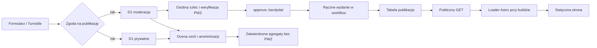

# Historie pacjentów

Implementacja lokalna, bez deployu i zasobów produkcyjnych. Wszystkie flagi są domyślnie
wyłączone. Przejście testów nie potwierdza podstawy prawnej, anonimizacji, zgodności z
warunkami źródeł ani limitu CPU Cloudflare Free.

## Przepływ i granice



`lib/historie/contract.mjs` zawiera czyste funkcje i JSDoc; pozostałe moduły operują na
tym kontrakcie. Formularz i API współdzielą walidację. SQL jest parametryzowany,
decyzje zapisujemy jako zdarzenia z aktorem i datą. Kontakt ma osobną tabelę.
Nazwisko lekarza i PWZ są lokalną parą; nazwisk nie dzielimy spacjami ani kropkami.

## Kontrakt przyjęcia i importu

`POST /api/historie`, JSON:

```json
{
  "version": 1,
  "idempotencyKey": "a112a300-20cd-40aa-919c-64082e3fa141",
  "turnstileToken": "świeży token",
  "consentVersion": "historie-2026-10-13",
  "title": "Moje doświadczenie",
  "body": "Własna relacja, zwykły tekst.",
  "city": "Wrocław",
  "facility": "Nazwa placówki",
  "doctors": [{ "name": "Nazwa osoby", "pwz": "2123456" }],
  "source": {
    "description": "Opis źródła", "url": "https://www.medonet.pl/material",
    "excerpt": "Prywatny materiał pomocniczy", "extractor": "manual", "truncated": false
  },
  "contactEmail": "osoba@example.test",
  "healthDataConsent": true,
  "publicationRequested": false
}
```

Tytuł, własna treść, aktualna wersja zgody i wyraźna zgoda dotycząca danych o zdrowiu
są wymagane. Publikacja jest osobnym, niezaznaczonym domyślnie wyborem. Pozostałe
pola są opcjonalne; dodany wiersz lekarza wymaga nazwy. E-mail służy wyłącznie kontaktowi;
przyszłe wykorzystanie antyspamowe wymaga osobnej zmiany celu i polityki.
Pole tekstowe jest tekstem, nie HTML ani Markdown; Astro je escapuje.

| Pole | Limit po NFC, w punktach kodowych Unicode |
|---|---:|
| title / body | 160 / 50 000 |
| city / facility | 120 / 240 |
| doctors / name / pwz | 20 wierszy / 160 / dokładnie 7 cyfr |
| source.description / url / excerpt | 300 / 2048 / 14 000 |
| contactEmail / turnstileToken | 254 / 2048 |
| publiczny cytat | 600, z obowiązkowym źródłem |
| Całe żądanie | 512 KiB, także bez Content-Length |

Odpowiedź `201 { id, warnings }`. Ten sam klucz i znormalizowane dane w tej samej kolejce
zwracają ten sam `id`; kontakt jest częścią porównania, token nie jest zapisywany ani
hashowany. Zmienione dane pod tym samym kluczem: `400 idempotency-conflict`.
Powtórka wymaga świeżego tokenu. Zmiana formularza tworzy nowy klucz.
Klucze są niezależne między bazami; wybór innej zgody stanowi nowe zgłoszenie.

Błędy mają `{ error, field?, retryable }`, bez wartości pól: `400` kontrakt,
`403` Turnstile lub niedozwolony host, `413` limit, `503` wyłączenie lub awaria.
Nie ma automatycznych powtórek. Przy niepewnym zapisie użytkownik ponawia ręcznie
zamrożone żądanie. Nie używamy fallbacku e-mail, bo dostępny jest zapis server-side.

Cyfra kontrolna NIL: `KABCDEF`, `K=(A+2B+3C+4D+5E+6F) mod 11`, K=1..9.
Niezgodność jest ostrzeżeniem przy przyjęciu i blokadą publikacji numeru. Nie dowodzi
poprawnej tożsamości. [Algorytm NIL](https://nil.org.pl/rejestry/centralny-rejestr-lekarzy/zasady-weryfikowania-nr-prawa-wykonywania-zawodu).

`POST /api/historie/import`: `{ url, turnstileToken }`, odpowiedź
`{ source: { description, url, excerpt, extractor, truncated }, providerLimited }`.
„Wstaw materiał źródłowy” zmienia tylko `source`, nigdy `body`. Sam podgląd nie jest
zapisem w bazie. Przy błędzie dotychczasowa relacja pozostaje w formularzu.
Po imporcie i wysyłce wywołujemy `turnstile.reset()`.

Ręczna allowlista w `import-profiles.mjs` zawiera początkowo siedem dokładnych hostów.
JSON-LD musi wskazywać bieżący artykuł; nie przeszukujemy pól komentarzy. Fallback
HTMLRewriter wymaga jednego oznaczonego `articleBody`, usuwa nawigację, komentarze,
reklamy i kod oraz dekoduje encje przez `entities`. Brak jednoznacznej treści jest błędem.
X używa publicznego oEmbed, wyłącznie głównego paragrafu wpisu; długi wpis może być
skrócony przez dostawcę. Nie logujemy się i nie obchodzimy ograniczeń dostępu.

HTTPS, port 443, bez credentials, literałów IP i dowolnych subdomen; każde przekierowanie
sprawdzamy ponownie przy `redirect: manual`. Maksymalnie 3 przekierowania, 8 sekund,
1 MiB rozpakowanego HTML, 64 KiB na JSON-LD / 128 KiB łącznie. Limit 14 000 stosujemy
po oczyszczeniu i NFC. Dodanie hosta wymaga ręcznej oceny i fikstur głównej treści
oraz komentarzy; sam publiczny URL nie dowodzi prawa do kopiowania.

## Lokalne uruchomienie

Node z `.nvmrc`, `npm ci`, `npm test`, `npm run check`. Emulator D1 wymaga localhost.

```bash
npm run historie -- init
HISTORIE_AKTYWNE=true HISTORIE_FIKSTURY=true npm run dev
```

Dev z fiksturami pokazuje strony, ale nie uruchamia Functions. Pełny podgląd API lokalnie:

```bash
HISTORIE_AKTYWNE=true HISTORIE_FIKSTURY=true npm run build -- --mode test
npx wrangler pages dev dist --d1 HISTORIE_MODERACJA_DB --d1 HISTORIE_PRYWATNE_DB --persist-to .wrangler/state --binding BASIC_AUTH_ENABLED=false
```

Konfiguracja `.dev.vars` jest ignorowana przez Git i zawiera lokalne flagi oraz osobne
klucze Turnstile historii. Walidacja dostawcy pozostaje rzeczywista; odpowiedź musi
zawierać zgodne action/hostname. Emulator nie pomija zabezpieczenia przy błędzie.
Fikstury służą wyłącznie dev i testom; takiego artefaktu nie deployujemy.
Zwykły produkcyjny build z `HISTORIE_FIKSTURY=true` kończy się błędem.
Przed produkcyjnym buildem testowym usuwamy flagę fikstur. Produkcja nie ma fallbacku.

CLI i Wrangler używają `.wrangler/state/v3/d1` oraz identyfikatorów równych nazwom
bindingów. `--persist PATH` zmienia katalog CLI (odpowiednik `--persist-to PATH`).
Migracja wspólna trafia do obu baz, druga tylko do moderacji. Nigdy nie mieszamy baz.
Nie dodano produkcyjnych bindingów historii do `wrangler.toml`.

## Moderacja i publikacja

```bash
npm run historie -- list --queue moderacja
npm run historie -- list --queue prywatne
npm run historie -- show UUID --queue moderacja
npm run historie -- show UUID --queue moderacja --contact
npm run historie -- draft UUID --file /chroniony-katalog/draft.json --actor redaktor-1
npm run historie -- verify-pwz UUID --pwz NUMER --match --actor redaktor-1
npm run historie -- approve UUID --pwz NUMER --actor redaktor-2
npm run historie -- preview-public
```

Plik szkicu zawiera wyłącznie `title`, `body`, opcjonalne `cytat` i `source: {description?,url?}`.
Nie kopiuje automatycznie surowego tekstu ani excerpt. Znane nazwiska, e-mail i numery
PWZ z pól prywatnych są blokowane w tekście szkicu; nadal potrzebna jest ręczna ocena
wszystkich identyfikatorów, danych zdrowotnych, zarzutów, praw cytatu i źródeł.

`verify-pwz` to ręczne sprawdzenie nazwy w CRL i jawne `--match`, z datą i moderatorem.
`approve` bez `--pwz` wybiera zero numerów. Każdy `--pwz` wymaga swojej wcześniejszej
weryfikacji; powtarzamy flagę dla wielu numerów. To weryfikacja tożsamości, nie faktów.
Ślad decyzji publicznych nie zachowuje prywatnej nazwy. Prywatnej kolejki nie można
zatwierdzić do publikacji; zmiana zakresu zgody wymaga nowego świadomego zgłoszenia.

`approve` zapisuje **kandydata**, nie publiczny feed. `reject` usuwa kandydata;
odrzucenie nowego szkicu nie usuwa wcześniejszej publikacji. Slug jest losowy,
niewyprowadzany z tytułu. Publiczna tabela zawiera tylko slug, tytuł, treść, cytat,
źródło, zatwierdzone PWZ, datę i identyfikator wydania. GET zwraca jawną selekcję pól;
nie czyta prywatnych tabel. `preview-public` jest lokalnym podglądem, nie eksportem
plików do `src/content`.

Workflow na `main`, ręcznie: opcja `wydaj_historie` i chronione środowisko
`historie-wydanie`. Wąski `POST /api/historie/wydanie` ma tylko operację wydania,
bez możliwości podania SQL. Id wydania jest deterministyczny dla runu; powtórka nie
wydaje nowych kandydatów. Po błędzie sprawdzamy feed i ponawiamy to samo UUID
(można podać `wydanie_id` w nowym ręcznym runie). CLI `release` działa tylko lokalnie.

Job wydania otrzymuje tylko `HISTORIE_RELEASE_KEY`. Build otrzymuje zero sekretów
Cloudflare i zwykłym HTTP pobiera `GET /api/historie/publikacje`; oczekuje wydania
potwierdzonego przez workflow. Asynchroniczny loader Content Layer tworzy kolekcję
bez plików historii. Paginacja sprawdza spójność wydania; błąd, niepoprawne pole,
zmiana wydania lub brak źródła przerywają build. Job deployu dostaje token Pages
bez D1:Edit. Istniejące provisioning D1/KV usunięto z workflow; zasoby już zadeklarowane
pozostają w `wrangler.toml`.

Odrębny token moderatora `HISTORIE_D1_TOKEN` służy tylko jawnej opcji `--remote`.
D1 API ma zakres konta, więc token nie jest sekretem buildu. Remote CLI przekazuje
SQL i `params` osobno w batch HTTP. Nie używamy `wrangler d1 execute --command`
z treścią zgłoszenia. [D1 query API](https://developers.cloudflare.com/api/resources/d1/subresources/database/methods/query/).

## Retencja, analiza i usuwanie

```bash
npm run historie -- classify UUID --queue prywatne --file /chroniony-katalog/cechy.json --actor redaktor-1
npm run historie -- analysis-preview
npm run historie -- analysis-approve --snapshot UUID --file /chroniony-katalog/cells.json --risk-reviewed --actor redaktor-1
npm run historie -- purge --queue moderacja
npm run historie -- purge --queue prywatne
npm run historie -- delete UUID --queue prywatne
npm run historie -- withdraw h-LOSOWYSLUG --actor redaktor-1
```

Cechy: `category`, `region` (województwo lub nieustalone), `year` (rok lub null),
`facilityType`. Zamknięte słowniki są w kontrakcie. Robocza klasyfikacja wskazuje
zgłoszenie i podlega retencji. Długoterminowa `analiza` przechowuje tylko zatwierdzone
komórki `{category,region,year,facilityType,count}` z progiem 5. Limit jednego snapshotu:
40 komórek. Brak miast, placówek, miesięcy, PWZ i identyfikatorów zgłoszeń.

Moderator przed `--risk-reviewed` porównuje podgląd z komórkami, ocenia rzadkość,
różnicowanie między snapshotami i możliwość ponownej identyfikacji. Próg 5 i usunięcie
identyfikatorów nie dowodzą anonimizacji; unsafe komórki łączymy lub pomijamy. Analiza
obejmuje obie kolejki i liczy relacje, nie zweryfikowane zdarzenia ani unikalnych pacjentów.
Nie budujemy statystyk konkretnych lekarzy.

`purge` to ta sama funkcja w CLI i Workerze Cron. Usuwa porcję do 20 zgłoszeń po
12 miesiącach kalendarzowych UTC, kontakt, excerpt, robocze cechy i zdarzenia.
Cron wykonuje porcję dla obu baz, raportuje tylko liczby; kolejne uruchomienia
kontynuują zaległości. Przy zaległościach powtarzamy CLI ręcznie. Niepublikowane
kandydaty z wygasłych zgłoszeń nie trafiają do wydania. Publikacje i minimalny dowód
zgody / publicznych decyzji zostają do wycofania, agregaty poza retencją surowych danych.

Obie bazy mają minimalny dziennik usunięć: id, data i przyczyna, bez treści i kontaktu.
`purge` czyści wpisy starsze niż 31 dni (maksymalne Time Travel + jedna doba).
Jedna porcja używa stałej liczby zapytań, także przy 20 zgłoszeniach.

Wycofanie wymaga więcej niż usunięcia wiersza:

1. `withdraw` (lub `delete` przed retencją) usuwa publiczny feed i kandydata. Zmiana
   wydania zatrzymuje trwający build poprzedniej wersji. Po retencji używamy sluga.
2. Ręcznie uruchamiamy workflow **bez** `wydaj_historie`, aby przebudować bieżący feed,
   Pagefind i sitemapę oraz wdrożyć usunięcie. Sprawdzamy adres i wyszukiwanie.
3. Usuwamy wszystkie starsze deploymenty Pages zawierające historię, w tym preview
   i adresy `<hash>.zarobkilekarzy.pages.dev`. Bieżący produkcyjny deployment zastępujemy
   przed usuwaniem. Sprawdzamy także aliasy i kopie artefaktów buildów.
4. Czyścimy cache CDN, wyszukiwarki i kontrolowane archiwa w zakresie dostępnych narzędzi.
   Kopie poza kontrolą projektu są uczciwie opisane w zgodzie.
5. Dokumentujemy realizację żądania. Przy odtwarzaniu D1 najpierw uwzględniamy dziennik
   usunięć i żądania wykonane po punkcie odtworzenia; nie otwieramy przywróconej bazy
   dla API przed ponownym purge/usunięciami. Dziennik trzeba zabezpieczyć przed samym restore.

D1 Time Travel: [7 dni Free / 30 dni Paid](https://developers.cloudflare.com/d1/platform/limits/).
Starsze deploymenty i ich aliasy: [Pages preview deployments](https://developers.cloudflare.com/pages/configuration/preview-deployments/).
Usunięcie deploymentu wymaga osobnego operatora z właściwymi uprawnieniami Pages;
nie jest automatyczną, ukrytą konsekwencją CLI. Wycofanie pozostaje otwarte do potwierdzenia
usunięcia kontrolowanych kopii. Nie przywracamy starego deploymentu po żądaniu usunięcia.

## Konfiguracja i warunki aktywacji

| Zmienna / binding | Zakres |
|---|---|
| HISTORIE_AKTYWNE=true | build: trasy, linki, kolekcja, polityka i sitemap |
| HISTORIE_PUBLIKACJE_URL | build: publiczne HTTPS `/api/historie/publikacje` tego serwisu |
| HISTORIE_OCZEKIWANE_WYDANIE | build: potwierdzone UUID lub `empty`, ustawia workflow |
| HISTORIE_FIKSTURY=true | wyłącznie dev/test, zabronione w produkcyjnym buildzie |
| HISTORIE_API_AKTYWNE=true | runtime API, domyślnie wyłączone |
| HISTORIE_IMPORT_AKTYWNY=true | runtime import, osobna bramka CPU / źródeł |
| TURNSTILE_HISTORIE_SITE_KEY / SECRET_KEY | osobne klucze historii; oba wymagane |
| TURNSTILE_HISTORIE_HOSTNAMES | dokładne hosty, domyślnie `zarobkilekarzy.pl` |
| HISTORIE_RELEASE_KEY | sekret min. 32 znaków, wyłącznie operacja wydania |
| HISTORIE_MODERACJA_DB / HISTORIE_PRYWATNE_DB | dwa oddzielne D1 |
| HISTORIE_RETENCJA_AKTYWNA=true | Worker Cron z osobnymi bindingami i harmonogramem |

Przed jakąkolwiek aktywacją produkcyjną:

- Potwierdzenie administratora, podstawy z art. 6 i 9 RODO, treści zgód, retencji,
  dostawcy i danych osób trzecich. Konsultacja prawna publikacji PWZ, zarzutów i prawa
  cytatu; prywatność nazwisk nie anonimizuje PWZ. Uzupełnienie informacji prawnej
  (w szczególności podstawy dotyczącej identyfikatorów lekarzy) i polityki zanim build
  pokaże formularz. Obecne brzmienie jest częścią wyłączonej implementacji.
  Uzgodnienie uprawnionego korzystania z CRL: [NIL opisuje ograniczone cele dostępu
  i umowy dla organizacji](https://nil.org.pl/rejestry/centralny-rejestr-lekarzy).
- Ustalenie redakcji, procedury sprostowania/sprzeciwu i zabezpieczenie kontaktu.
  Formalne określenie celów analizy i ocena anonimizacji.
- Ręczne utworzenie dwóch baz i migracji oraz osobnej konfiguracji Cron. Dopiero po
  osobnej autoryzacji zasoby i bindingi produkcyjne można dodać do konfiguracji.
- Osobne klucze Turnstile, rotacja sekretu wydania, token moderatora poza CI,
  token deployu bez D1:Edit. Ochrona środowisk `historie-wydanie` i `production`
  w GitHub oraz wyłączenie równoległego automatycznego deployu w integracji Pages.
- Wyłączenie cache dla `/api/historie/*`, także w regułach strefy (istniejące reguły
  mogą nadpisywać `no-store`). Test produkcyjnej odpowiedzi i procedury usuwania
  starszych deploymentów. Brak prywatnych danych w logach, analityce i repo.
- Pomiar CPU przy najgorszych dozwolonych wejściach w rzeczywistym planie Cloudflare.
  Free ma [10 ms CPU](https://developers.cloudflare.com/workers/platform/limits/).
  Lokalny Miniflare nie kwalifikuje tego limitu. Import pozostaje wyłączony do pomiaru;
  w razie przekroczenia zmniejszamy limity/profile lub świadomie wybieramy inny plan.
  Testujemy też intake, wydanie i porcję Cron, a nie tylko ekstrakcję.

Bootstrap po spełnieniu bramek: deploy kodu z UI wyłączonym, przygotowanie baz/kluczy,
API z działającym pustym publicznym feedem, potem build z flagą UI i publicznym źródłem.
Nie stosujemy fikstur do bootstrapu produkcji. Niniejsze zadanie nie wykonuje tych operacji.

## Tracker i weryfikacja

Workflow zapisuje potwierdzone wydanie w publicznym `historie-wydanie.json` artefaktu
i ponownie porównuje je z feedem przed deployem. Zmiana lub wycofanie po buildzie
zatrzymuje taki deploy. Przy pilnym wycofaniu operator zatrzymuje również aktywny
workflow i blokuje rollback; pojedyncza kontrola nie jest transakcją obejmującą D1 i Pages.

Opcjonalny test przeglądarkowy po syntetycznym buildzie: `node tests/historie-browser.mjs`.
Wymaga Playwright/Chromium; `PLAYWRIGHT_MODULE` i `BROWSER_EXECUTABLE` mogą wskazać
istniejące instalacje. Sieć jest zablokowana, Turnstile zastąpiony lokalną fiksturą,
a formularz komunikuje się z rzeczywistym API w emulatorze. Nie używamy sekretów.

| Zadanie | Zależności | Implementacja |
|---|---|---|
| HIST-01 kontrakt i feature gate | — | gotowa |
| HIST-02 migracje, kontakt, idempotencja | HIST-01 | gotowa |
| HIST-03 formularz i fail-closed Turnstile | HIST-01, HIST-02 | gotowa |
| HIST-04 importer JSON-LD/HTMLRewriter/X | HIST-01, HIST-03 | gotowa, bramka CPU otwarta |
| HIST-05 CLI, szkic, PWZ i zdarzenia | HIST-01, HIST-02 | gotowa |
| HIST-06 wydanie, publiczny endpoint i loader | HIST-05 | gotowa |
| HIST-07 retencja i agregaty obu kolejek | HIST-02, HIST-05 | gotowa |
| HIST-08 testy, dokumentacja i polityka | HIST-03…HIST-07 | lokalna weryfikacja |
| HIST-09 aktywacja i kwalifikacja runtime | HIST-08, bramki powyżej | niewykonana |

`npm test` sprawdza prawdziwy lokalny D1/workerd, a sieć zewnętrzna jest zastąpiona
fiksturami. Testy obejmują routing obu kolejek, idempotencję, tokeny, błędy, izolację
kontaktu, niepublikowalność niezweryfikowanego PWZ, osobną decyzję numeru, publiczną
whitelistę, retencję, wycofanie po retencji, analizę oraz natywny importer i SSRF.
Loader sprawdza awarię źródła i zakaz fikstur w produkcji. Buildy sprawdzamy osobno
z flagą wyłączoną i na syntetycznej kolekcji w trybie testowym. To dowód lokalnego
zachowania, bez kwalifikacji planu Cloudflare i bez publikacji.
