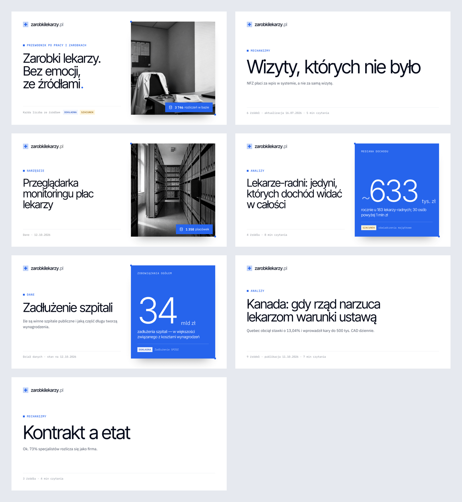

# System obrazków OG — specyfikacja

Status (15.10.2026): **wdrożone** (`src/lib/og/`, `src/pages/og/`, `src/data/og.ts`, meta w `BaseLayout`). Kierunek **A „Okładka”** obejmuje wszystkie podstrony i pozwala nadpisać obrazek dla konkretnej strony. Makiety pochodzą z prototypu (`og-propozycje/system/prototyp.mjs`). Kod produkcyjny ma kilka poprawek z testów wdrożeniowych (§5).




## 1. Założenia

1. **Jedna rodzina, stała anatomia.** Każdy obrazek ma te same strefy: logo, etykieta (eyebrow), tytuł, lead, stopka po lewej oraz media po prawej. Zmienia się treść stref, a nie układ. Dzięki temu w feedzie każdy link z serwisu wygląda „nasz”.
2. **Zero pracy przy typowej stronie.** Obrazek powstaje z danych, które strona już ma (tytuł, sekcja, lead, okładka, źródła, data). Redakcja ingeruje tylko wtedy, gdy chce lepszego efektu.
3. **Nadpisywanie warstwami.** Można zmienić pojedyncze pole (np. sam tytuł) bez przepisywania całej konfiguracji. Można też podać własną, ręcznie zaprojektowaną grafikę.
4. **Marka = źródła.** Stopka zawsze dowodzi źródłowości: liczba źródeł, data aktualizacji albo etykieta Dokładna/Szacunek.

## 2. Warianty mediów (prawa strona)

| Wariant | Kiedy | Wygląd |
|---|---|---|
| `photo` | strona ma zdjęcie (strona główna, artykuł z `cover`) | zdjęcie B&W w ramce z narożnymi uchwytami, opcjonalny niebieski badge (`badge`, np. „1 358 placówek”). Liczba na początku badge'a jest automatycznie pogrubiana |
| `stat` | dział danych albo artykuł, którego hakiem jest liczba | kobaltowa karta: etykieta, duża liczba z jednostką, opis i pasek źródła z flagą Dokładna/Szacunek. To ten sam język co `Badge variant="stat"` i karta wyróżniona |
| `none` | brak zdjęcia i liczby (**domyślne dla artykułów**: dziś okładkę ma 1 z 21 materiałów) | tytuł na pełną szerokość, większy krój. Typograficzna karta w duchu szwajcarskim |

Wybór automatyczny (`media: auto`): `og.image` → własny plik, `og.stat` → `stat`, zdjęcie (`og.photo` albo `cover`) → `photo`, w pozostałych przypadkach `none`.

## 3. Mapowanie typów stron (presety)

| Typ strony | Etykieta | Tytuł | Lead | Media | Stopka |
|---|---|---|---|---|---|
| Strona główna | „Przewodnik po pracy i zarobkach” | ręcznie, z podziałami wierszy | — | `photo` (hero) + badge „3 746 rozliczeń w bazie” | „Każda liczba ze źródłem” + flagi |
| Artykuł `/[sekcja]/[id]/` | etykieta sekcji, jak w okruszkach (`sectionOf`) | `title` | pierwsze zdanie `summary` | auto | „6 źródeł · aktualizacja 16.07.2026 · 5 min czytania” |
| Indeks sekcji `/mechanizmy/`, `/analizy/` (wpis w `data/og.ts`) | etykieta sekcji | redakcyjny nagłówek z ręcznym podziałem | opis sekcji | `none` | „Każda teza ze źródłem” |
| Dział danych `/dane/`, `/dane/<dział>/` (wpis w `data/og.ts`) | „Dane” (+ nazwa działu) | redakcyjny nagłówek | opis | `stat`: kluczowa liczba; może być liczona z danych działu, wtedy aktualizuje się sama | „Dział danych · stan na …” + flagi |
| Narzędzie | „Narzędzia” | tytuł | `summary` | auto | „Narzędzie · aktualizacja …” |
| Pojęcie słowniczka *(przyszłe)* | „Słowniczek” | `term` | `full` | `none` | „Słowniczek” |
| Strony stałe (wyszukiwarka, metodologia, sprostowania) | rodzaj strony | tytuł | opis | `none` | „Bez emocji, ze źródłami.” (domyślna stopka wpisów z `data/og.ts`) |
| Brak wpisu (404, nowa trasa) | obrazek domyślny serwisu (= strona główna) i ostrzeżenie w buildzie |

Nowy typ strony to nowy preset: jedna funkcja `dane strony → OgSpec`. Szablonu i endpointu się nie rusza.

## 4. Kaskada nadpisań

```
0. obrazek domyślny serwisu       /og/index.png — siatka bezpieczeństwa
1. preset typu strony             automatycznie z danych (tabela wyżej)
2. nadpisanie `og:`               pojedyncze pola scalane na presecie
3. własny plik `og.image`         gotowa grafika 1200×630 — omija generator
```

**Artykuły i inne kolekcje:** pole `og` we frontmatterze. Każde pole jest opcjonalne:

```yaml
og:
  title: "Lekarze-radni:\njedyni, których dochód widać"  # krótszy tytuł do social; \n = ręczny podział wiersza
  eyebrow: Analiza                 # zamiast etykiety sekcji
  lead: false                      # tekst albo false (ukryj)
  media: stat                      # auto | photo | stat | none
  stat:                            # karta liczby
    value: "~633"                  # znak ~ > < rozpoznawany automatycznie
    unit: tys. zł
    label: Mediana dochodu
    desc: rocznie u 183 lekarzy-radnych; 30 osób powyżej 1 mln zł
    accuracy: est                  # exact | est → flaga Dokładna / Szacunek
    source: oświadczenia majątkowe
  photo: ../../assets/img/temat-kontrakty.jpg   # inne zdjęcie niż cover
  position: 40% 50%                # punkt kadrowania (jak object-position)
  badge: "1 358 placówek"          # albo false
  image: ../../assets/og/kampania-lek.png       # gotowa grafika — wygrywa ze wszystkim
```

**Strony spoza kolekcji** (strona główna, 404, przyszłe strony jednorazowe) mają te same pola w jednym rejestrze `src/data/og.ts` (`trasa → nadpisanie`). Zmienia się tylko miejsce zapisu, nie kształt danych.

Tekst `og:title`/`og:description` w meta jest niezależny od tekstu na obrazku. Krótszy `og.title` na grafice nie zmienia tytułu w podglądzie linku.

## 5. Reguły typograficzne (automatyczne)

- **Rozmiar tytułu** zależy od długości i szerokości kolumny:
  - z mediami (546 px): 80 / 70 / 60 / 52 / 46 px dla ≤18 / ≤34 / ≤56 / ≤80 / więcej znaków;
  - bez mediów (cała szerokość, 1072 px): 104 / 88 / 72 / 60 px.
- **Ręczne podziały (`\n`):** krój rośnie do szerokości najdłuższego wiersza (≈0,46 em/znak), ale nie spada poniżej progu wynikającego z długości. Za długi wiersz po prostu się zawinie.
- **Końcowy znak tytułu** ma kolor akcentu, jak w `ui/Heading`. Gdy tytuł nie kończy się znakiem, dopisywana jest kropka.
  - W Satori kolorowy znak trzyma się ostatniego słowa tylko wtedy, gdy słowa są osobnymi elementami flex-wrap. Zwykły tekst + span rozjeżdżał się przy zawinięciu.
  - **Bez wdowy:** dwa ostatnie słowa tytułu i leadu łączy twarda spacja (przy więcej niż dwóch słowach).
- **Polska typografia:** tytuł, lead i badge przechodzą przez istniejące `typo()` z `lib/format.ts` (sierotki, liczby z jednostkami).
- **Lead:** pierwsze zdanie `summary`. Skróty („tys.”, „ok.”, „r.”, „art.”…) nie kończą zdania. To złapał test na „…do 500 tys. CAD dziennie”, który w pierwszej wersji urywał się na „tys.”. Zdanie dłuższe niż 120 znaków oznacza brak leadu: lepiej nic niż ucięty tekst. Lead pojawia się tylko przy krótkim tytule.
- **Ostrzeżenie w buildzie** pojawia się, gdy tytuł przekroczy 80 znaków w kolumnie z mediami („skróć albo ustaw `og.title`”), gdy trasa nie ma wpisu w rejestrze OG, albo gdy zdjęcie jest mniejsze niż ramka (470×518).

## 6. Technologia (zweryfikowana prototypem)

| Element | Wybór | Dlaczego |
|---|---|---|
| Układ → SVG | **Satori 0.57.2** (dokładnie ta wersja) | czysty JS (bez przeglądarki w buildzie), flexbox, cienie, `object-fit`. ~30–150 ms na obrazek |
| SVG → PNG | **sharp** (już w zależnościach) | Satori zamienia tekst na krzywe, więc librsvg nie potrzebuje fontów |
| Fonty | **@fontsource/inter-tight, ibm-plex-sans, ibm-plex-mono 5.3.0**, statyczne WOFF (w `dependencies`, obok sharp, bo potrzebne w buildzie) | statyczne wagi dają przewidywalny skład. Pliki z Fonts API Astro są zmienne (WOFF2 Satori czyta od 0.55, ale tego nie potrzebujemy) |
| Zdjęcia | sharp: kadr wg `position`, skala szarości, JPEG w data URI | ten sam efekt co `grayscale(1) contrast(1.05)` na stronie |
| Format | PNG z paletą 8-bit | B&W + kilka kolorów marki mieści się w palecie: 10–130 KB bez widocznej straty |
| Ikony, tokeny | `src/icons.ts`, `src/styles/tokens.css` (parsowane) | jedno źródło prawdy, bez kopiowania kolorów |

Pułapki znalezione w prototypie (do README po wdrożeniu):
- **Polskie znaki.** Podzbiór latin-ext trzeba zarejestrować jako osobną rodzinę (`Inter Tight Ext`) i podawać jawny stos `'Inter Tight, Inter Tight Ext'`. Przy tej samej nazwie Satori gubi ł/ż/ą/ę. Bez stosu znaki z latin-ext spadają do innego kroju (mono robił się proporcjonalny).
- Każdy `div` z więcej niż jednym dzieckiem musi mieć `display: flex` (`block` jest odrzucany). Robi to helper `h()`.
- Plik zdjęcia wskazuje `import.meta.glob` po `src/assets` i dopasowanie po `src`, a nie prywatne `ImageMetadata.fsPath`. Zdjęcia do OG muszą więc leżeć w `src/assets`.
- **Satori:** w październiku 2026 wyszło 45 wydań (zwykle 1–3 miesięcznie). Wydanie 0.57.2 zweryfikowano 15.10.2026 przed podpięciem:
  - publikacja z GitHub Actions z atestacją SLSA (`npm audit signatures`);
  - commit to `main` w vercel/satori, autor: opiekun projektu;
  - brak skryptów instalacyjnych.
- **Zmiana w 0.4x–0.5x:** nowy silnik układu zamiast `yoga-layout` liczy domyślnie `content-box` jak przeglądarka. Bez `boxSizing: 'border-box'` (domyślnie w `h()`) ramka wyjeżdżała za kadr, a stopka znikała pod dolną krawędzią. Po każdym podbiciu wersji trzeba porównać obrazki z poprzednimi.

## 7. Architektura (zgodna z warstwami serwisu)

```
src/
  types.ts         OgStat, OgOverride (pole `og`), OgPage (wpis w data/og.ts)
  lib/og/
    schema.ts      zod dla pola `og` we frontmatterze (ścisły — literówka zatrzymuje build)
    presets.ts     dane strony → OgSpec (artykuł, strona z rejestru); kaskada nadpisań; OgSpec/OgEntry
    registry.ts    getOgEntries(): wszystkie trasy z obrazkiem; ogImageFor(pathname) → URL + ?v=hash
    render.ts      szablon (h(), układ, media) + fonty + sharp → PNG
  data/og.ts       strony spoza kolekcji (strona główna = obrazek domyślny)
  pages/og/[...route].png.ts       endpoint statyczny, getStaticPaths z rejestru
  pages/og-podglad/[...rest].astro galeria wszystkich obrazków — tylko w `astro dev`
  assets/          zdjęcia i ręcznie zaprojektowane grafiki (poziom 3 kaskady) — tylko stąd
```

- **Adres:** `/og/<trasa>.png`, np. `/og/mechanizmy/fikcyjne-wizyty.png`. Dla strony głównej: `/og/index.png`. Strony nic nie wpinają: `BaseLayout` sam wylicza obrazek ze ścieżki.
- **Meta w `BaseLayout`:** `og:image` (+ `:width`, `:height`, `:type`, `:alt` = tytuł z obrazka), `twitter:card=summary_large_image`, `twitter:site=@ZarobkiLekarzy`.
- **Odświeżanie cache platform:** URL dostaje `?v=<hash specyfikacji>`. Po zmianie tytułu czy liczby Facebook/LinkedIn/X pobiorą nowy obrazek, a plik statyczny ignoruje parametr.
- **Podgląd `/og-podglad/`:** siatka wszystkich obrazków z adresami i ostrzeżeniami. Redakcja zmienia frontmatter i od razu widzi efekt. Strona nie trafia do builda.
- **Koszt buildu:** ~70 ms na stronę (fonty ładowane raz, kadry zdjęć cache'owane). 100 stron to ~7 s.

## 8. Decyzje (15.10.2026)

1. Artykuły bez okładki mają czystą typograficzną kartę (`none`), bez dodatkowego elementu marki.
2. Etykieta artykułu to etykieta sekcji („Mechanizmy”), jak w okruszkach i na stronie.
3. Wdrożone od razu, równolegle z pracą nad widokiem artykułu.

Uwaga do makiet: stopki makiet 4, 6 i 7 (liczba źródeł, czas czytania) oraz lead działu danych (makieta 5) są przykładowe, bo te materiały nie mają jeszcze treści.
